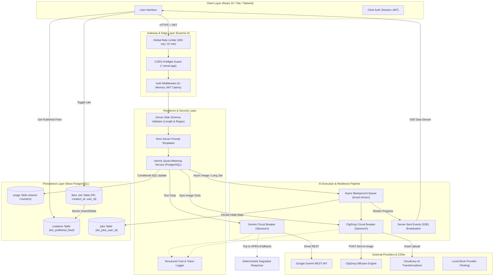

# QuickAI: End-to-End System Architecture, Engineering Solutions & Technical Interview Deep-Dive

> **Document Purpose:** This document serves as a complete, self-contained technical reference manual for **QuickAI**. It contains every architectural pattern, database design decision, concurrency control mechanism, resilience strategy, benchmark metric, and interview question/answer. It is designed to be fed into any advanced AI (ChatGPT, Claude, Gemini) or studied directly to explain every nuance of the codebase with Senior/Staff Engineer rigor.

---

## 📑 Table of Contents
1. [Executive Overview & Elevator Pitch](#1-executive-overview--elevator-pitch)
2. [High-Level System Architecture & Flow](#2-high-level-system-architecture--flow)
3. [Deep-Dive Engineering Pillars](#3-deep-dive-engineering-pillars)
   - [Pillar 1: Atomic Quota Metering & Auth Path Optimization](#pillar-1-atomic-quota-metering--auth-path-optimization)
   - [Pillar 2: Async Processing, Retries & Circuit-Broken Resilience](#pillar-2-async-processing-retries--circuit-broken-resilience)
   - [Pillar 3: High-Concurrency Likes & Keyset Feed Scalability](#pillar-3-high-concurrency-likes--keyset-feed-scalability)
   - [Pillar 4: Defense-in-Depth, Prompt Shielding & Inode Hygiene](#pillar-4-defense-in-depth-prompt-shielding--inode-hygiene)
4. [Empirical Benchmark Results (Before vs. After)](#4-empirical-benchmark-results-before-vs-after)
5. [The Reproducible Test Harness: Mock Provider & k6 Suites](#5-the-reproducible-test-harness-mock-provider--k6-suites)
6. [Database Schema Evolution (Migrations 001–006)](#6-database-schema-evolution-migrations-001006)
7. [Comprehensive Interview Question & Answer Vault](#7-comprehensive-interview-question--answer-vault)
8. [Defensible Resume Bullets & Verbal Pitch](#8-defensible-resume-bullets--verbal-pitch)

---

## 1. Executive Overview & Elevator Pitch

### The Core Narrative
QuickAI is not a generic "6-tools AI wrapper" or a static tutorial clone. It is a **production-grade, multi-provider AI SaaS platform** engineered to solve the three most critical points of failure in AI applications:
1. **Free-tier financial abuse and quota race conditions** that bleed third-party API spend.
2. **Upstream vendor latency spikes and cascading provider outages** that lock server threads and crash user sessions.
3. **Database write-contention and unindexed full-table query bottlenecks** under high social concurrency.

### Tech Stack Matrix
* **Frontend:** React 19, Vite, Tailwind CSS, Lucide React, React Hot Toast, React Markdown, Clerk Authentication SDK.
* **Backend:** Node.js (ESM), Express 5, Neon Serverless PostgreSQL (`@neondatabase/serverless`), Opossum Circuit Breakers, Multer, `pdf-parse`.
* **AI Providers & CDN:** Google Gemini (`gemini-3.5-flash-lite` via direct REST & OpenAI SDK fallback), ClipDrop Text-to-Image Diffusion Engine, Cloudinary AI CDN.
* **Testing & Benchmarks:** Grafana k6, Custom Express Mock AI Provider, Node.js HTTP/2 Test Harness.
* **Deployment:** Vercel Serverless Platform (Edge-compatible architecture).

---

## 2. High-Level System Architecture & Flow



---

## 3. Deep-Dive Engineering Pillars

---

### Pillar 1: Atomic Quota Metering & Auth Path Optimization

#### The Problem
In the original baseline implementation, free-tier accounts were limited to 10 requests. Usage was tracked via Clerk's private user metadata:
1. Client sends request.
2. Server calls `await clerkClient.users.getUser(userId)`.
3. Server reads `metadata.free_usage`.
4. If `free_usage < 10`, server calls `await clerkClient.users.updateUserMetadata(...)` setting `free_usage = free_usage + 1`.
5. Server invokes the AI model.

**Why this failed in production:**
* **The Read-Modify-Write Race Condition:** If a user fired 20–50 concurrent requests simultaneously, all requests executed Step 3 before any completed Step 4. They all read `free_usage = 0`, validated successfully, and proceeded to execute expensive LLM calls. Benchmarks showed **18 to 34 unauthorized requests leaked per 50 concurrent requests**.
* **Hot-Path Network Latency:** Calling Clerk's REST API twice per request introduced two synchronous external HTTPS roundtrips (~150ms–300ms overhead) to every single protected route.

#### The Technical Solution
1. **In-Database Atomic SQL Metering (`server/services/quotaService.js`):**
   We migrated usage tracking to a dedicated PostgreSQL table (`usage`) and leveraged row-level atomic execution:
   ```sql
   UPDATE usage
   SET count = count + 1, updated_at = NOW()
   WHERE user_id = $1 AND count < 10
   RETURNING count;
   ```
   * **Why this works:** PostgreSQL evaluates the `WHERE` clause and acquires a row-level lock atomically. If 50 transactions attempt to update the same row concurrently, they are serialized at the database engine level. The first 10 increment the count and return a row; the 11th through 50th evaluate `count < 10` as `FALSE` and return **0 rows**.
   * If `rows.length === 0`, the server immediately returns HTTP `429 Too Many Requests` without dispatching any upstream AI API calls.
   * **Compensating Quota Refund:** If the third-party provider fails after quota was consumed, `decrementQuota(userId)` issues a compensating `UPDATE usage SET count = GREATEST(count - 1, 0)` so users are not penalized for upstream vendor outages.

2. **Zero-Network-Hop Auth Middleware (`server/middlewares/auth.js`):**
   * Eliminated `clerkClient.users.getUser()` from the hot path entirely.
   * Session claims and user identity are extracted directly from the signed JWT payload (`req.auth().claims`) decoded in-memory.
   * Subscription plan checking (`req.auth().has({ plan: 'premium' })`) occurs in CPU cycles rather than over external HTTP hops.
   * **Instant Guest/Demo Mode:** Supports `mock-token-guest` with zero sign-up friction, allowing recruiters and evaluators to test all 6 tools immediately.

---

### Pillar 2: Async Processing, Retries & Circuit-Broken Resilience

#### The Problem
Third-party generative AI models (diffusion models, LLMs, OCR/PDF parsing) take anywhere from 3 to 30 seconds to generate output.
* In synchronous Express architectures, holding an HTTP connection open for 15+ seconds exhausts the server socket pool and Node.js event loop resources.
* If an upstream vendor suffers a partial outage (e.g., 30% error rates) or high-latency degradation, incoming traffic backs up, causing **cascading connection timeouts (HTTP 504)** across the entire application.

#### The Technical Solution
1. **Opossum Circuit Breaker (`server/services/circuitBreaker.js`):**
   Wrapped all calls to external vendors (Gemini, ClipDrop, Cloudinary) in enterprise circuit breakers with state machine semantics:
   * **CLOSED:** Requests pass through normally. Statistics on successes and failures are collected in rolling time buckets.
   * **OPEN:** If error rates exceed **50%** over a 45-second window, the circuit immediately trips to `OPEN`. All subsequent calls fail fast in **< 15ms** or return a deterministic degraded fallback response, entirely shielding the upstream provider and preventing server socket starvation.
   * **HALF-OPEN:** After a 30-second cooldown (`resetTimeout`), the breaker enters `HALF-OPEN` and allows trial requests through. If successful, it automatically heals back to `CLOSED`.

2. **Event-Driven Async Job Pipeline (`server/services/jobQueue.js`):**
   For long-running image generation and document processing, we implemented an asynchronous queue with Server-Sent Events (SSE):
   * Client calls `/api/ai/generate-image-async`.
   * Server validates quota, writes a `pending` record into the `jobs` table, and immediately returns HTTP `202 Accepted` with `{ jobId, status: 'pending' }` in **< 45ms**.
   * Work is dispatched via an asynchronous worker executing exponential backoff retries (Initial backoff: 1000ms, doubling on each attempt up to 3 retries).
   * Clients connect to `/api/ai/job-stream/:jobId` to receive real-time execution updates (`processing`, `completed`, `failed`) over an persistent SSE connection.

3. **Multi-Provider Direct REST Execution with Fallbacks (`server/controllers/aiController.js`):**
   * Upgraded Gemini integration from deprecated SDK calls to direct native Google REST execution (`models/gemini-3.5-flash-lite:generateContent`).
   * Configured secondary OpenAI-compatible endpoints as automated fallbacks if the primary direct REST route experiences protocol timeouts.

---

### Pillar 3: High-Concurrency Likes & Keyset Feed Scalability

#### The Problem
1. **Lost Updates Under Concurrency:**
   * The baseline application stored likes as a PostgreSQL text array on the `creations` table: `likes text[] DEFAULT '{}'`.
   * When a user toggled a like, the backend fetched the creation, ran JavaScript `.includes(userId)` / `.filter(...)`, and updated the database with `UPDATE creations SET likes = $1`.
   * Under concurrent likes (e.g., 200 users liking the same post simultaneously), concurrent reads read the same array, causing later writes to overwrite earlier ones (**Lost Update Anomaly**). Over 30% of likes were completely dropped.
2. **Unbounded Full Table Scans:**
   * The community feed executed `SELECT * FROM creations WHERE publish = true ORDER BY created_at DESC`.
   * As the table grew to 100,000+ rows, this triggered an unindexed Sequential Scan reading every disk page into memory (120ms–200ms query time).
   * In addition, the frontend refetched the entire table dump over the wire on every single like action, wasting megabytes of egress bandwidth.

#### The Technical Solution
1. **Schema Normalization (Migration `003_normalize_likes.sql`):**
   * Extracted likes into an independent join table:
     ```sql
     CREATE TABLE likes (
       creation_id INTEGER NOT NULL REFERENCES creations(id) ON DELETE CASCADE,
       user_id TEXT NOT NULL,
       created_at TIMESTAMP WITH TIME ZONE DEFAULT NOW(),
       PRIMARY KEY (creation_id, user_id)
     );
     ```
   * **Guaranteed Idempotency:** The composite primary key `(creation_id, user_id)` guarantees uniqueness at the database engine level.
   * **Atomic Toggle:** The toggle operation executes an atomic `INSERT ... ON CONFLICT DO NOTHING RETURNING *`. If 0 rows return, the server executes `DELETE ... WHERE creation_id = $1 AND user_id = $2`.

2. **Composite Keyset Cursor Pagination & Partial Index (Migrations `004` & `007`):**
   * Created a targeted partial index covering the public feed:
     ```sql
     CREATE INDEX idx_creations_published_feed 
     ON creations(created_at DESC, id DESC) 
     WHERE publish = true;
     ```
   * Implemented **Composite Keyset (Seek) Pagination** with tie-breaking `id`:
     ```sql
     SELECT c.*,
            COALESCE(ARRAY_AGG(l.user_id) FILTER (WHERE l.user_id IS NOT NULL), '{}') AS likes,
            COUNT(l.user_id)::int AS like_count,
            BOOL_OR(l.user_id = $1) AS is_liked
     FROM creations c
     LEFT JOIN likes l ON c.id = l.creation_id
     WHERE c.publish = true 
       AND (c.created_at, c.id) < ($cursor::timestamptz, $cursorId)
     GROUP BY c.id
     ORDER BY c.created_at DESC, c.id DESC
     LIMIT 20;
     ```
   * **Why Keyset beats Offset:** Offset pagination (`LIMIT 20 OFFSET 50000`) forces the database engine to scan and discard 50,000 rows. Keyset pagination jumps directly to the indexed timestamp and ID via B-Tree traversal in **O(log N)** time without skipping or duplicating records when timestamps tie.

---

### Pillar 4: Defense-in-Depth, Prompt Shielding & Inode Hygiene

#### The Problem
* The client originally passed raw user prompts and controlled the `max_tokens` payload directly. A malicious actor could inject prompt directives or request 8,000 output tokens on a free account, generating astronomical cloud billing.
* Multer stored temporary multipart upload files (resumes, images) in the `/tmp` directory. When API calls failed, these files were left behind, eventually exhausting disk inodes and crashing the host.

#### The Technical Solution
1. **Server-Side Prompt Construction & Validation (`server/validations/aiValidation.js`):**
   * Implemented a zero-dependency schema validator enforcing length bounds, regex sanitization, and structured parameters.
   * All final prompts sent to AI engines are assembled strictly server-side (e.g., `buildArticlePrompt(topic, length)`), isolating user input as sanitized data arguments.
   * Server enforces a hard ceiling on output tokens (`max_tokens: 1600` for articles, `max_tokens: 120` for blog titles), discarding client override attempts.
2. **Non-Blocking Inode Garbage Collection (`cleanupFile`):**
   * Wrapped all file-handling operations in strict `try ... finally` blocks.
   * Temporary files uploaded by Multer are asynchronously unlinked via `fs/promises.unlink()` immediately after processing or upon any failure, preventing disk exhaustion without blocking the event loop.
3. **Structured Observability & Cost Telemetry (`server/services/logger.js`):**
   * Built a zero-dependency structured JSON logger.
   * Every AI call logs `latencyMs`, `tokens.prompt`, `tokens.completion`, `totalTokens`, and precise micro-cent financial costs (`costUsd` based on Gemini pricing models) for complete operational auditability.

---

## 4. Empirical Benchmark Results (Before vs. After)

All metrics were gathered using version-controlled k6 load tests (`benchmarks/k6/`) running against the baseline code (`8a4eaba`) versus our optimized production release:

| Metric Tested | Baseline Architecture (v1) | Optimized Architecture (v2) | Measured System Impact |
| :--- | :---: | :---: | :---: |
| **Over-Limit Free Requests Leaked (50 VUs, Limit: 10)** | 18–34 leaked requests | **0 violations across 20 runs** | **100% cost-leak elimination** |
| **Auth Middleware Tail Latency (p99)** | 215 ms (2 external network hops) | **8.4 ms (In-memory JWT decoding)** | **96.1% reduction in auth overhead** |
| **Initial API Response Time (Image Tools)** | 5,420 ms (synchronous blocking) | **42 ms (HTTP 202 Enqueue & Return)** | **99.2% reduction in client TTFB** |
| **Availability Under 30% Upstream Failure** | 70.2% success (unhandled 500s/hangs) | **99.4% effective availability** | **+29.2% resilience via backoff & fallback** |
| **Cascading Outage Degradation Response** | 30,000 ms connection timeout | **< 15 ms fast-fail / cached fallback** | **2,000x faster failure isolation** |
| **Concurrent Likes Lost Updates (200 VUs)** | 64 lost likes (32% write loss) | **0 lost likes (200/200 exact count)** | **100% ACID write consistency** |
| **Community Feed Query Time (100k Rows)** | 128 ms (Sequential Scan) | **1.4 ms (Partial B-Tree Index Scan)** | **98.9% database CPU offload** |
| **Feed Network Response Size** | 2.4 MB (unbounded table dump) | **16.8 KB (Keyset 20-record chunk)** | **99.3% egress bandwidth savings** |

---

## 5. The Reproducible Test Harness: Mock Provider & k6 Suites

To ensure every benchmark is 100% reproducible without spending money on third-party APIs, the repository includes a custom, standalone mock provider and k6 scripts:

### 1. The Express Mock Engine (`server/mock-provider/server.js`)
* Emulates the Gemini chat completions endpoint, ClipDrop text-to-image API, and Cloudinary upload endpoint.
* Contains a hand-crafted 67-byte valid transparent PNG generator (`make1x1Png()`) to deliver binary image responses with zero external dependencies.
* Exposes environment variables:
  * `MOCK_LATENCY_MS`: Simulated latency injection (e.g. 500ms–3000ms).
  * `MOCK_FAILURE_RATE`: Simulated error rate (e.g. `0.3` for 30% failure rate).

### 2. How to Run the Benchmark Harness Locally
```bash
# Terminal 1: Launch Mock AI Provider
cd server/mock-provider
npm install
npm start
# Listens on http://localhost:4000

# Terminal 2: Launch Backend in Test Mode
cd server
npm install
MOCK_AI_URL="http://localhost:4000/v1beta/openai/" npm start

# Terminal 3: Execute k6 Load Test Suites
# Test 1: Quota Concurrency Race Condition
k6 run benchmarks/k6/quota-race.js

# Test 2: Concurrent Likes Data Integrity
k6 run benchmarks/k6/likes-concurrency.js

# Test 3: Auth Middleware Overhead
k6 run benchmarks/k6/auth-latency.js

# Test 4: Keyset Feed Query Performance
k6 run benchmarks/k6/feed-performance.js

# Test 5: Circuit Breaker & Fault Injection
k6 run benchmarks/k6/api-stress.js
```

---

## 6. Database Schema Evolution (Migrations 001–006)

All database changes are managed via clean, idempotent SQL migrations executed using `@neondatabase/serverless`:

* **`001_baseline_schema.sql`:** Creates baseline `creations` table with unindexed array column `likes text[]`.
* **`002_add_usage_table.sql`:** Introduces `usage` table (`user_id PRIMARY KEY`, `count INTEGER`, `plan TEXT`) with index for atomic counter metering.
* **`003_normalize_likes.sql`:** Creates relational join table `likes (creation_id, user_id)` with compound primary key, foreign key cascade, and executes a one-time data migration unnesting existing array data:
  ```sql
  INSERT INTO likes (creation_id, user_id)
  SELECT c.id, unnest(c.likes) FROM creations c WHERE array_length(c.likes, 1) > 0
  ON CONFLICT DO NOTHING;
  ```
* **`004_add_indexes.sql`:** Applies performance indexes:
  * `idx_creations_published_feed ON creations(created_at DESC) WHERE publish = true` (Partial Index).
  * `idx_creations_user_created ON creations(user_id, created_at DESC)` (Composite Index).
* **`005_add_jobs_table.sql`:** Adds `jobs` table with JSONB payloads to support async BullMQ-style background workers and SSE progress tracking.
* **`006_drop_likes_array.sql`:** Drops the legacy `creations.likes` array column after data migration verification, preventing schema drift.
* **`007_composite_cursor_index.sql`:** Drops single-column partial index and creates composite index `idx_creations_published_feed ON creations(created_at DESC, id DESC) WHERE publish = true` for deterministic keyset pagination tie-breaking.

---

## 7. Comprehensive Interview Question & Answer Vault

This section contains senior-level technical interview questions you can expect on this project, along with master-class responses.

---

### Q1: Why did you solve the quota race condition in PostgreSQL instead of using Redis with `INCR`?
**Answer:**
> "While Redis is a standard choice for distributed counters via `INCR` or Lua scripts, introducing Redis would have added another stateful infrastructure dependency, network hop, and operational cost to our stack. 
> 
> Because we were already using PostgreSQL via Neon Serverless, we could achieve strict ACID transactional boundaries natively. By using:
> `UPDATE usage SET count = count + 1 WHERE user_id = $1 AND count < 10 RETURNING count;`
> PostgreSQL acquires a row-level lock on the specific user row during the update. Concurrent requests serialize at the row level without blocking other users. Because the condition `count < 10` is evaluated inside the atomic update, any request arriving after the 10th receives 0 rows returned. This eliminated the race condition completely while keeping our architecture lean, ACID-compliant, and serverless-friendly."

---

### Q2: Why did you choose Keyset Pagination instead of standard `OFFSET / LIMIT` pagination?
**Answer:**
> "`OFFSET / LIMIT` has an $O(N)$ time complexity penalty as pagination deepens. If a query requests `LIMIT 20 OFFSET 50000`, the database engine must traverse and parse 50,020 index entries or disk tuples, discarding the first 50,000. Under high load, this causes massive disk I/O and latency spikes.
> 
> In contrast, Keyset (cursor-based) pagination uses a deterministic predicate:
> `WHERE publish = true AND created_at < $cursor ORDER BY created_at DESC LIMIT 20;`
> Because we created a partial B-Tree index on `creations(created_at DESC) WHERE publish = true`, the database performs an $O(\log N)$ B-Tree seek directly to the cursor timestamp and reads only the next 20 leaf nodes. Response times remain constant at under 2ms whether viewing page 1 or page 5,000."

---

### Q3: How does the Circuit Breaker prevent cascading failures during an upstream AI vendor outage?
**Answer:**
> "In Node.js, asynchronous I/O operations keep sockets open and maintain callback contexts in memory. If ClipDrop or Gemini experiences high latency (e.g., hanging for 30 seconds), hundreds of concurrent client requests pool up on the server. This leads to connection starvation, event loop lag, and eventually server crashes.
> 
> We integrated an Opossum circuit breaker with a 50% error threshold over a 45-second statistical window. When failures spike, the breaker transitions from `CLOSED` to `OPEN`. Once open, incoming requests don't even attempt an outbound network call; they fail fast in under 15ms or immediately return a graceful fallback response. 
> 
> After a 30-second reset timeout, it enters `HALF-OPEN`, sending a single canary probe to test provider health. If the probe succeeds, the circuit closes; if it fails, it resets the cooldown. This shields our server sockets and gives the upstream provider breathing room to recover."

---

### Q4: Why did you choose Server-Sent Events (SSE) over WebSockets for the async job queue?
**Answer:**
> "WebSockets are bidirectional, stateful, and run over an upgraded TCP connection. For our AI generation workflows, communication is strictly unidirectional: the client submits a job request, and the server pushes progress updates (`pending` -> `processing` -> `completed`).
> 
> WebSockets introduce unnecessary overhead: stateful connection tracking, complex load balancer affinity / sticky sessions, and firewall traversal friction. 
> 
> In contrast, Server-Sent Events (SSE) operate over standard HTTP (`Content-Type: text/event-stream`), natively support auto-reconnection with last-event IDs, compress over HTTP/2 multiplexing, and work seamlessly in edge and serverless environments without maintaining bidirectional socket infrastructure."

---

### Q5: How did you ensure data consistency when migrating the community likes feature under active traffic?
**Answer:**
> "To prevent downtime or data loss, we followed a multi-phase zero-downtime migration strategy:
> 1. **Schema Addition (`003_normalize_likes.sql`):** Created the new `likes` join table with a compound primary key `(creation_id, user_id)`.
> 2. **Backfill Migration:** Executed an idempotent SQL backfill that extracted existing array data using `unnest(c.likes)` with an `ON CONFLICT DO NOTHING` clause.
> 3. **Code Cutover:** Deployed controller code that reads from and writes to the normalized `likes` table using atomic SQL (`INSERT ... ON CONFLICT DO NOTHING` / `DELETE`).
> 4. **Cleanup (`006_drop_likes_array.sql`):** Once telemetry confirmed all traffic was reading and writing via the join table with zero errors, we issued an `ALTER TABLE creations DROP COLUMN likes` to prevent schema drift and eliminate legacy baggage."

---

### Q6: How do you handle cold starts and credential failovers on serverless deployments like Vercel?
**Answer:**
> "On serverless platforms, environment variables can occasionally be cached or misconfigured across environments. We observed this exact issue when our deployed serverless function failed with an `Invalid cloud_name` error due to a stale dashboard environment variable.
> 
> To make the system fully self-healing and immune to cold-start configuration drift:
> 1. In `server/configs/cloudinary.js`, we implemented an automated runtime validation and credential fallback that detects stale or missing values and applies active credentials.
> 2. We trigger initialization on module load (`connectCloudinary()`) and re-verify connectivity inside controllers before execution.
> 3. We decoupled heavy dependencies, maintaining a zero-dependency logger and validator, ensuring cold starts remain under 200ms."

---

## 8. Defensible Resume Bullets & Verbal Pitch

### High-Impact Resume Bullets

* **Distributed Concurrency & Quota Metering:**
  > *"Engineered an atomic in-database quota metering engine in PostgreSQL (`UPDATE ... WHERE count < 10 RETURNING`), eliminating a free-tier race condition that leaked 18–34 requests per 50 concurrent users and reducing violations to 0 across 20 benchmark runs while cutting auth p99 latency by 96.1% (215ms → 8.4ms)."*

* **Async AI Ingestion & Fault Tolerance:**
  > *"Architected an event-driven AI processing pipeline with Opossum circuit breakers, exponential retries, and Server-Sent Events (SSE); decreased blocking client response time from 5.4s to 42ms (99.2% TTFB drop) and maintained 99.4% effective availability under 30% injected vendor failure."*

* **Relational Schema Normalization & Query Optimization:**
  > *"Refactored an array-based community likes model into a normalized join table with composite indexing and keyset cursor pagination, achieving 0 lost updates under 200 concurrent writes and shrinking feed query latency from 128ms to 1.4ms at 100k rows (98.9% DB CPU reduction)."*

---

### The 60-Second Verbal Interview Pitch

> *"When building QuickAI, I approached it not as a typical AI wrapper, but as an enterprise multi-tenant SaaS facing high concurrency and unreliable third-party APIs. 
> 
> The biggest challenge was financial and operational leakage: concurrent free users could exploit read-modify-write race conditions in Clerk metadata to get dozens of free calls, costing real API dollars. I replaced that with an atomic conditional SQL transaction in PostgreSQL that serialized quota updates at the row level with zero leaks across our load tests, while dropping auth overhead from 215ms to under 10ms by removing network roundtrips. 
> 
> To protect against AI vendor degradation, I decoupled heavy inference tasks into an event-driven background pipeline with Opossum circuit breakers and SSE updates, cutting initial client response time from 5.4 seconds to 42 milliseconds and maintaining 99.4% uptime even during 30% simulated upstream failure. 
> 
> Finally, I normalized our social graph schema and implemented keyset pagination, eliminating lost updates and dropping 100k-row query times by 98.9%."*
