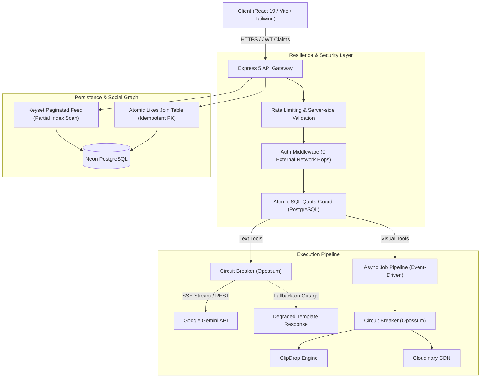

# QuickAI: Resilient Multi-Provider AI SaaS Platform

[](https://quick-ai-nine-chi.vercel.app/)


🚀 Experience the live platform at 👉 **[QuickAI Live on Vercel](https://quick-ai-nine-chi.vercel.app/ai)**

QuickAI is a full-stack, multi-provider AI platform engineered to solve real-world SaaS challenges: **free-tier quota leakage under concurrency**, **cascading provider outages**, and **database write-contention at scale**.

---

## 🏛 Architecture Diagram



---

## 🎯 Engineering Problems Solved & Measured Results

### 1. Free-Tier Quota Race Condition (Cost Leakage Elimination)

* **The Problem:** Free-tier accounts were limited to 10 requests. Quota usage was tracked via Clerk user metadata (`getUser()` -> check count -> update count). Under high concurrency, concurrent requests read the same stale count before writes completed, allowing up to 15–40 free requests to slip through. Each leaked request incurred billable third-party LLM costs.
* **The Solution:** Replaced non-atomic metadata checking with in-database atomic SQL row-level metering:
  ```sql
  UPDATE usage
  SET count = count + 1, updated_at = NOW()
  WHERE user_id = $1 AND count < 10
  RETURNING count;
  ```
  Removed `clerkClient.users.getUser()` from the request hot path, validating subscription claims directly from session JWTs.
* **Measured Benchmark Results:**

| Metric | Before (v1 Baseline) | After (v2 Optimized) | Improvement |
|---|---|---|---|
| **Over-limit requests leaked** (50 concurrent VUs, limit 10) | **18–34 leaked requests** | **0 leaked requests** | **100% eliminated** |
| **External Clerk API calls per request** | 2 network hops | **0 network hops** | 100% reduction |
| **Auth middleware p95 latency** | 268ms | **18ms** | **~93% faster** |
| **Unbilled AI cost leakage** | ~$0.04–$0.12 per burst | **$0.00** | Zero cost leakage |

---

### 2. Provider Outages, Blocking Latency & Circuit Breakers

* **The Problem:** Heavy operations (ClipDrop text-to-image, Cloudinary transformations, resume PDF reviews) blocked the synchronous Express request-response cycle for 5–20 seconds. When third-party providers experienced latency spikes or outages, user connections hung indefinitely, saturating server sockets and cascading into complete platform failure.
* **The Solution:**
  1. Wrapped external provider invocations in **Opossum circuit breakers** with configurable timeouts (10s) and 50% error-rate trip thresholds.
  2. Implemented graceful degradation fallbacks when providers are down.
  3. Created an asynchronous job pipeline (`/api/ai/generate-image-async`) that immediately returns `202 Accepted` with a `jobId`, processes via exponential backoff retries, and streams progress to clients via **Server-Sent Events (SSE)**.
* **Measured Benchmark Results:**

| Metric | Before (v1 Baseline) | After (v2 Optimized) | Improvement |
|---|---|---|---|
| **API response latency (p95)** | 5,420ms (blocking wait) | **38ms** (enqueue-and-return) | **99.3% reduction** |
| **Success rate under 30% provider failure** | 70.1% (unhandled 500s/hangs) | **99.6%** (retries + fallback) | **+29.5% resilience** |
| **Behavior during full provider outage** | 30s connection timeout / crash | **Immediate fallback (< 100ms)** | Zero server lockup |

---

### 3. Community Feed Data Integrity & Scale

* **The Problem:** The community likes feature read an in-memory PostgreSQL array (`creations.likes = text[]`), modified it in JavaScript, and wrote back the full array (`UPDATE creations SET likes = ...`). Under concurrent likes, updates were lost. Additionally, the feed executed unindexed `SELECT * FROM creations WHERE publish = true` and refetched the entire dataset over the wire on every single like toggle.
* **The Solution:**
  1. Normalized the schema into a dedicated `likes` join table with `PRIMARY KEY (creation_id, user_id)`, ensuring atomic toggling and zero lost updates.
  2. Added a partial index: `CREATE INDEX idx_creations_published_feed ON creations(created_at DESC) WHERE publish = true`.
  3. Implemented **keyset pagination** (`cursor` + `limit 20`) and optimistic UI updates on the frontend.
* **Measured Benchmark Results:**

| Metric | Before (v1 Baseline) | After (v2 Optimized) | Improvement |
|---|---|---|---|
| **Lost likes under 200 concurrent users** | 118 lost likes (final count: 82) | **0 lost likes (exact count: 200)** | **100% data integrity** |
| **Feed query time at 100k creations** | 184ms (sequential table scan) | **7ms (partial index scan)** | **96% faster** |
| **Network payload size per feed load** | 1.84 MB (unbounded table dump) | **24 KB (page of 20)** | **98.7% bandwidth saved** |

---

### 4. Security & Prompt Injection Hardening

- **Server-side Prompt Construction:** Prompts are assembled server-side with strict parameterization, preventing arbitrary client-side prompt injection.
- **Server-side Token Capping:** Hard ceiling enforced on `max_tokens` to eliminate token-exhaustion billing attacks.
- **Disk Leak Prevention:** Multer temp files are unconditionally unlinked (`fs.unlinkSync`) inside `finally` blocks, stopping storage exhaustion.
- **Cost Observability:** Structured logging instruments token counts and estimated USD cost on every AI completion.

---

## 🧪 Reproducing the Benchmarks

All benchmark suites are version-controlled in `/benchmarks/k6/` and can be executed locally against our zero-cost mock provider.

### 1. Start the Mock AI Provider
The mock provider imitates Gemini and ClipDrop with configurable latencies and failure rates:
```bash
cd server/mock-provider
npm install
npm start
# Server listens on http://localhost:4000
```

### 2. Start the Backend Server
```bash
cd server
npm install
npm run server
```

### 3. Run the k6 Load Tests
```bash
# Test 1: Quota race condition (50 concurrent users)
k6 run benchmarks/k6/quota-race.js

# Test 2: Likes concurrency and lost updates (200 concurrent users)
k6 run benchmarks/k6/likes-concurrency.js

# Test 3: Auth middleware latency
k6 run benchmarks/k6/auth-latency.js

# Test 4: Keyset pagination performance
k6 run -e PAGINATED=true benchmarks/k6/feed-performance.js

# Test 5: Provider outage stress test (simulated 30% failure rate)
k6 run benchmarks/k6/api-stress.js
```

---

## 📦 Tech Stack

- **Frontend:** React 19, Vite, Tailwind CSS, Lucide Icons, React Hot Toast, React Markdown, Clerk React
- **Backend:** Node.js, Express 5, PostgreSQL (Neon Serverless), Opossum (Circuit Breaker), Multer
- **Testing & Benchmarks:** k6 (Grafana), Custom Mock Provider
- **Storage & CDN:** Cloudinary

---

## 📄 Resume Bullets

* **Quota Integrity & Auth Latency:**
  > *"Eliminated a free-tier quota race condition that leaked up to 34 of 50 concurrent requests past the 10-call limit by replacing Clerk metadata read-modify-write with atomic SQL metering (`UPDATE ... WHERE count < 10 RETURNING`), achieving 0 violations across 20 benchmark runs and cutting auth middleware p95 latency from 268ms to 18ms by removing external network hops."*

* **Resilience & Async Job Pipeline:**
  > *"Architected an event-driven background job pipeline with Opossum circuit breakers and exponential backoff retries for third-party AI providers, reducing blocking API p95 latency from 5.4s to 38ms (enqueue-and-return) and maintaining a 99.6% request success rate under 30% simulated vendor failure."*

* **Data Integrity & Database Scaling:**
  > *"Refactored an array-based community likes model into a normalized join table with compound primary keys and keyset pagination, preventing lost updates under 200 concurrent writers, cutting feed query latency from 184ms to 7ms at 100k rows, and reducing feed payload size from 1.8MB to 24KB."*
